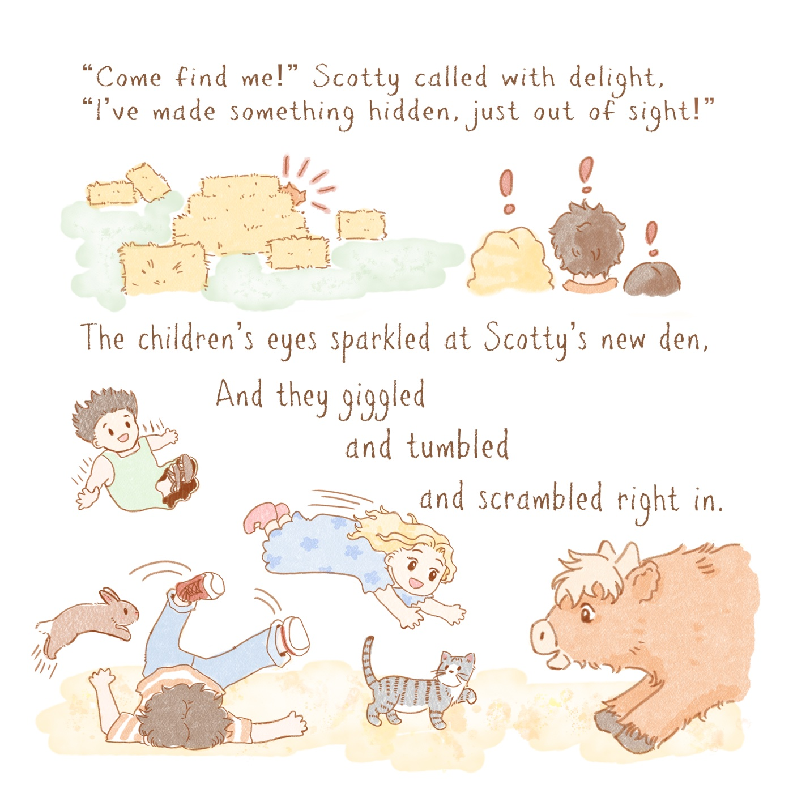

A few years ago, my then youngest daughter decided that her most precious possession was a small, stuffed Highland cow. She slept with it. She carried it with her everywhere. She would cry endlessly if we forgot it when going on a five minute walk around the lake by our house. Completely inseparable and in love with this gifted toy in a way only children can be.

She also loved to play a little game whenever someone was coming to visit (or even when my wife or I would return from an errand). The second she saw someone she knew approaching the house, she would run off and find a place to hide. When they entered, she'd giggle loudly and if she wasn't immediately spotted, she'd yell "Come find me!".

With a full heart and a fit of inspiration one night, I took to writing about her little cow playing this game, and "[Scotty's Secret Space](https://infernalmoose.com/products/scottys-secret-space)" was born. It's a short, ten page children's board book about Scotty building a fort for himself but coming to realize that sharing these special spaces is what we really want. The illustrations were done by my cousin and she absolutely blew me away.

Not only did she capture the feel of the book perfectly, she was able to incorporate my kids into the story in a perfect way. For each of them, there's also a little easter egg in the form of a brown bunny and a striped cat.

Why the cat? Well, immediately after I finished writing this story and started on the work to get it illustrated and printed, my daughter decided she was done with her Scotty and moved all of her love and devotion to her striped kitty instead. Kids, man.

If you'd like a copy of the book, you can order one [here](https://infernalmoose.com/products/scottys-secret-space).
